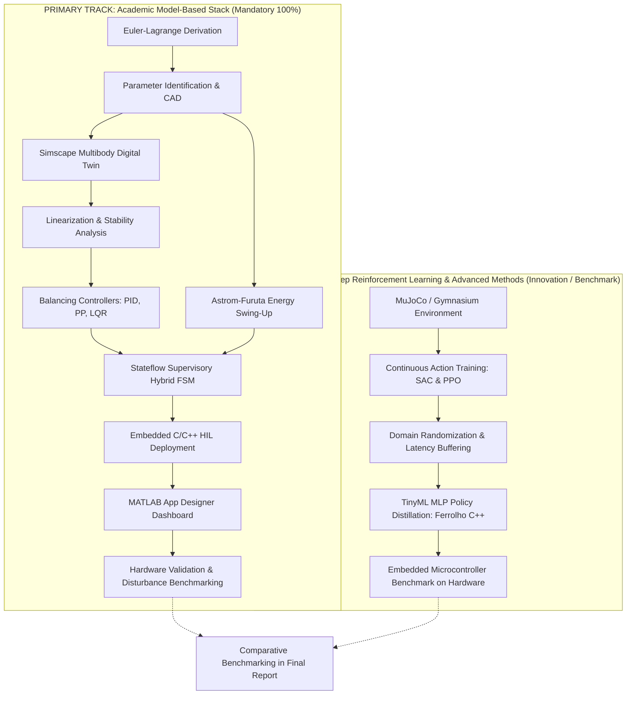
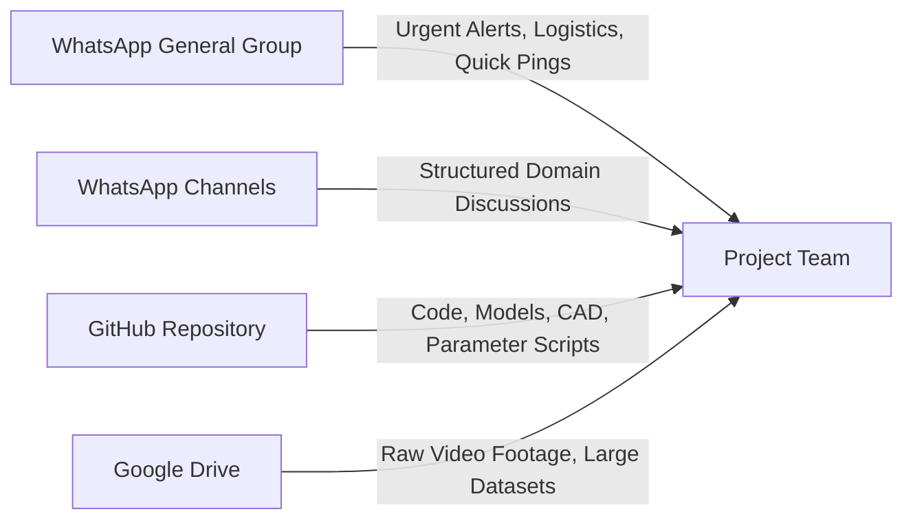
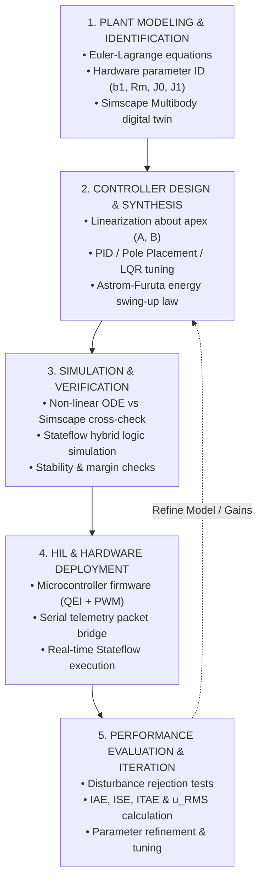
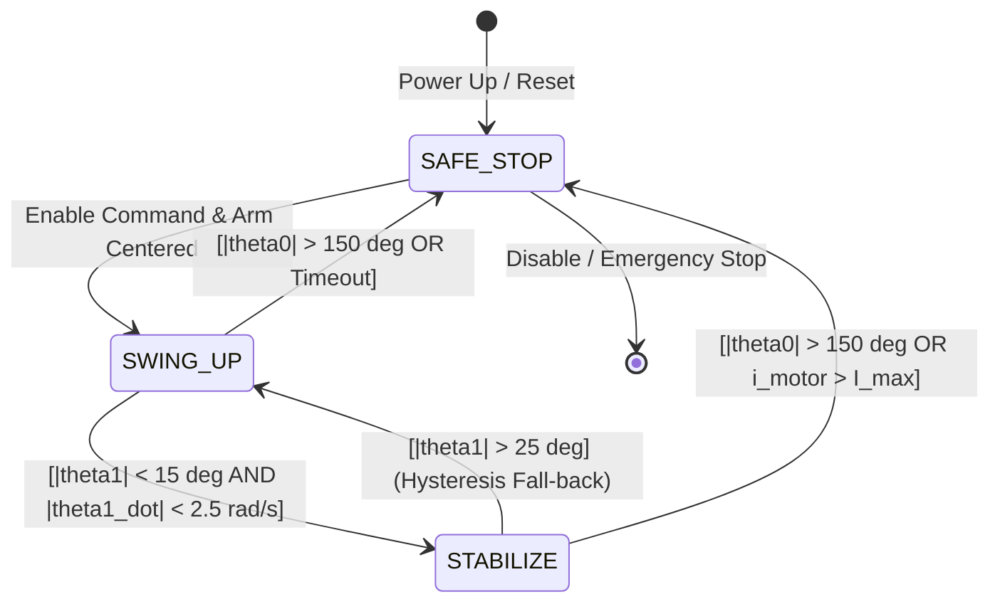
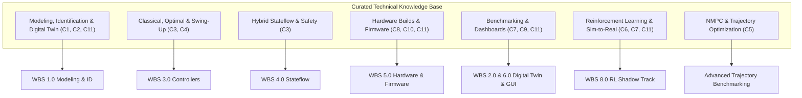
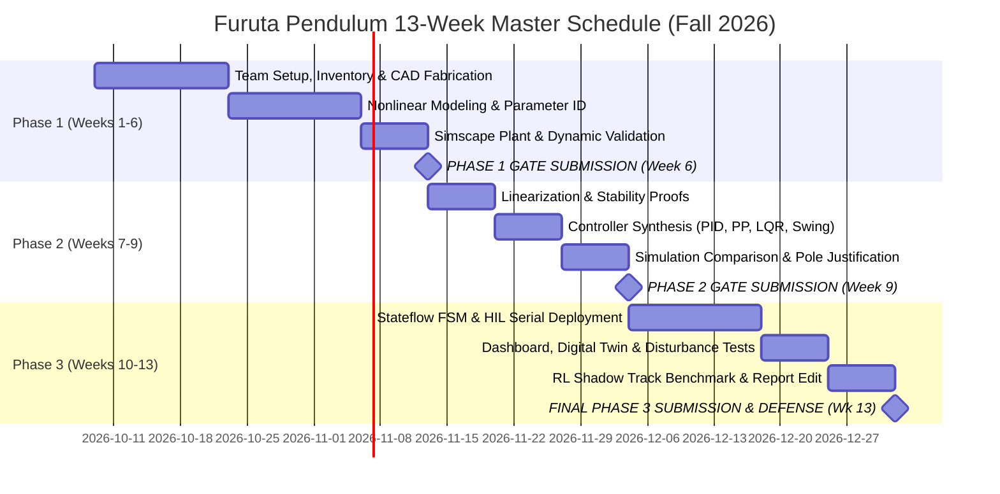

# Furuta Pendulum (Rotary Inverted Pendulum)
## Master Project Engineering Guide & Operational Roadmap

> **Course Context:** MCT411: Hybrid Control Systems | MCT413s: Control Systems Design (2) | MCT414: Modern Control  
> **Institution:** Faculty of Engineering, Ain Shams University — Mechatronics Engineering Department  
> **Academic Term:** Fall 2026  
> **Target System:** Furuta Rotary Inverted Pendulum — Modelling, Hybrid & Optimal Control, Real-Time HIL Dashboard, and Reinforcement Learning Benchmark  

---

## Table of Contents
1. [Executive Summary & Project Governance](#1-executive-summary--project-governance)
2. [Dual-Track Engineering Strategy](#2-dual-track-engineering-strategy)
3. [Team Formation, Pair Engineering & Accountability Matrix](#3-team-formation-pair-engineering--accountability-matrix)
4. [Structured Collaboration & Communication Protocol](#4-structured-collaboration--communication-protocol)
5. [Repository Architecture & Configuration Management](#5-repository-architecture--configuration-management)
6. [Standard Control Engineering Design Procedure](#6-standard-control-engineering-design-procedure)
7. [Comprehensive Work Breakdown Structure (WBS)](#7-comprehensive-work-breakdown-structure-wbs)
   - [WBS 1.0: Theoretical Modeling, Dynamics & Parameter Identification](#wbs-10-theoretical-modeling-dynamics--parameter-identification)
   - [WBS 2.0: Multibody Digital Twin & Open-Loop Simulation](#wbs-20-multibody-digital-twin--open-loop-simulation)
   - [WBS 3.0: Controller Design & Synthesis](#wbs-30-controller-design--synthesis)
   - [WBS 4.0: Hybrid Supervisory State Machine (Stateflow)](#wbs-40-hybrid-supervisory-state-machine-stateflow)
   - [WBS 5.0: Mechanical Fabrication, Embedded Firmware & HIL Deployment](#wbs-50-mechanical-fabrication-embedded-firmware--hil-deployment)
   - [WBS 6.0: Real-Time Dashboard & Telemetry Visualizer](#wbs-60-real-time-dashboard--telemetry-visualizer)
   - [WBS 7.0: Performance Benchmarking, Disturbance Testing & Validation](#wbs-70-performance-benchmarking-disturbance-testing--validation)
   - [WBS 8.0: Parallel Deep Reinforcement Learning (Shadow Track)](#wbs-80-parallel-deep-reinforcement-learning-shadow-track)
8. [Comprehensive Resource Mapping by Subsystem](#8-comprehensive-resource-mapping-by-subsystem)
9. [Hardware Telemetry & HIL Communication Protocol Contract](#9-hardware-telemetry--hil-communication-protocol-contract)
10. [13-Week Master Schedule & Milestone Alignment](#10-13-week-master-schedule--milestone-alignment)
11. [Technical Report Shell & Contribution Logging Model](#11-technical-report-shell--contribution-logging-model)
12. [Oral Defense Preparation & Grading Rubric Deconstruction](#12-oral-defense-preparation--grading-rubric-deconstruction)
13. [48-Hour Immediate Action Checklist](#13-48-hour-immediate-action-checklist)

---

## 1. Executive Summary & Project Governance

The **Furuta Rotary Inverted Pendulum** is an underactuated mechatronic benchmark featuring two rotational degrees of freedom driven by a single motorized actuator ($m=1, n=2$). A horizontal arm rotates in the plane perpendicular to gravity ($\theta_0$), while an unactuated pendulum rod pivots freely at its distal tip in the vertical plane ($\theta_1$). The system exhibits severe state-dependent Coriolis and centrifugal cross-couplings, non-Euclidean state configurations ($\mathbb{S}^1 \times \mathbb{S}^1$), and open-loop instability about its inverted vertical apex.

Stabilizing this platform directly exercises core competencies required across modern autonomous systems—including rocket thrust-vector control, bipedal humanoid postural balance, gantry crane anti-sway positioning, and self-balancing mobility platforms.

![[Pasted image 20261009221319.png|473]]

### Official Course Deliverables & Grading Weights
Per the official Ain Shams University Project Specification, final evaluation is governed by the following six grading criteria:

| # | Deliverable Component | Weight | Key Technical Targets |
|---|---|:---:|---|
| **1** | **Working Hardware Prototype with GUI/Dashboard** | **20%** | Physical prototype balancing in real time; GUI displaying $\theta_0$, $\theta_1$, motor control $u$; verified disturbance rejection against manual impulses. |
| **2** | **Synchronized Digital Twin** | **10%** | 3D multibody dynamic model running inside/alongside the dashboard, mirrored in real time with hardware state during HIL operation. |
| **3** | **Comprehensive Technical Report** | **20%** | Complete modeling proofs, parameter ID experiments, controller synthesis, hybrid Stateflow design, sim vs. actual benchmarking, and mandatory individual contribution log. |
| **4** | **Oral Defense & Discussion** | **15%** | Rigorous individual viva voce covering nonlinear dynamics, eigenvalue justification, loop margins, code implementation, and failure mode analysis. |
| **5** | **Simulation & Hybrid Controller (Simulink/Stateflow)** | **20%** | Full model-based architecture containing PID, Pole Placement, LQR, energy-based swing-up, and supervisory Stateflow chart with hysteresis guards. |
| **6** | **Demonstration Video (5 Minutes Max)** | **15%** | High-production video showcasing physical balance, disturbance recovery, HIL dashboard, digital twin synchronization, and technical methodology. |
| **Total** | **Official Evaluation** | **100%** | **Mandatory:** Omission of LQR/pole placement or Stateflow swing-up logic incurs severe point deductions. |

---

## 2. Dual-Track Engineering Strategy

To reconcile high academic requirements with ambitious Deep Reinforcement Learning (RL) experimentation, the project adopts a **Dual-Track Engineering Strategy**:



1. **The Primary Track (Model-Based Mechatronics Stack):**
   - Strictly satisfies all course mandates: Euler-Lagrange equations $\to$ parameter identification $\to$ Simscape plant $\to$ Jacobian linearization $\to$ PID, Pole Placement, and LQR $\to$ Åström-Furuta energy swing-up $\to$ Stateflow hybrid state machine $\to$ MATLAB App Designer telemetry $\to$ HIL microcontroller deployment.
   - Guaranteed baseline securing the maximum course grade.

2. **The Shadow Track (Reinforcement Learning & Advanced Benchmark):**
   - Parallel track utilizing MuJoCo physics, Gymnasium continuous observation embeddings ($[\cos\theta_0, \sin\theta_0, \cos\theta_1, \sin\theta_1, \dot{\theta}_0, \dot{\theta}_1]$), Soft Actor-Critic (SAC) and Proximal Policy Optimization (PPO) algorithms.
   - Sim-to-real transfer via domain randomization, distilled into a lightweight C++ Multi-Layer Perceptron (TinyML) following Henrique Ferrolho's open-source methodology ($\sim 689$ parameters).
   - Presented in the technical report as an advanced benchmark against classical and optimal controllers, evaluating transient recovery, control effort ($u_{\text{RMS}}$), and computational execution time.

---

## 3. Team Formation, Pair Engineering & Accountability Matrix

With a team of 6 to 8 students, flat task allocation leads to communication bottlenecks and unbalanced contributions. We enforce a **Pair Engineering Model**: team members operate in dedicated functional pairs with assigned primary ownership and cross-review responsibilities.

### Functional Pair Division

| Pair Designation                                          | Primary Functional Focus                                | Core Responsibilities                                                                                                                                                                                                                                                                                                                                             | Cross-Review Obligation                                                                                                                         |
| --------------------------------------------------------- | ------------------------------------------------------- | ----------------------------------------------------------------------------------------------------------------------------------------------------------------------------------------------------------------------------------------------------------------------------------------------------------------------------------------------------------------- | ----------------------------------------------------------------------------------------------------------------------------------------------- |
| **Pair 1: Dynamics & Modeling**<br>*(Members 1 & 2)*      | Theoretical Mechanics, Stability Analysis, Parameter ID | • Nonlinear Euler-Lagrange equations of motion.<br>• Linearization about apex and downward equilibria.<br>• Controllability and observability rank proofs.<br>• Physical parameter identification experiments ($b_1, R_m, k_t, J_0, J_1$).<br>• Simscape Multibody 3D twin construction.<br>• Real-time synchronization of 3D visualizer with live serial stream. | Cross-reviews Simscape plant (Pair 4) and controller gains (Pair 2).                                                                            |
| **Pair 2: Control Syntheses**<br>*(Members 3 & 4)*        | Classical, Optimal, Hybrid & RL Control                 | • PID tuning with low-pass derivative filtering.<br>• Full-state feedback pole placement (Ackermann).<br>• LQR Riccati solver and Bryson's rule weighting.<br>• Åström-Furuta energy swing-up law.<br>• Stateflow hybrid switching chart.<br>• Shadow Track RL agent training and TinyML distillation.                                                            | Cross-reviews firmware timing (Pair 3) and analytical matrices (Pair 1).                                                                        |
| **Pair 3: Hardware & Firmware**<br>*(Members 5 & 6)*      | Mechanical Assembly, Embedded Systems, HIL Firmware     | • CAD design, 3D printing (PETG/PLA+), bearing hubs.<br>• Motor driver circuit, optical encoder wiring, safety limits.<br>• Microcontroller firmware (hardware QEI timers, PWM generation).<br>• High-speed serial telemetry protocol implementation.<br>• Hardware emergency-stop and current protection.                                                        | Cross-reviews dashboard telemetry parser (Pair 4) and Stateflow guards (Pair 2).                                                                |
| **Pair 4: Benchmarking & Dashboard**<br>*(Members 7 & 8)* | App Designer, Benchmarking, Documentation               | • MATLAB App Designer telemetry dashboard.<br>• Disturbance logging scripts (IAE, ISE, ITAE, $u_{\text{RMS}}$).<br>• Report assembly, Git repository maintenance, and demo video production.                                                                                                                                                                      | Cross-reviews sync telemetry sync with Simscape digital twin and hardware communication packet (Pair 3) and physical parameter tables (Pair 1). |

*(Note: For 6-member teams, Pair 4 duties are distributed: Member 7 handles Dashboard & Digital Twin integration, while Member 8/Team Lead oversees System Integration, Documentation, and Video Production).*

### Formal Team Formation Sheet Template
*(To be submitted to the course instructor by the designated deadline)*

- **Institution:** Faculty of Engineering, Ain Shams University
- **Department:** Mechatronics Engineering Department
- **Course:** MCT411 / MCT413s / MCT414 — Fall 2026
- **Academic Section:** Section `[X]` *(All members must belong to the same section)*
- **Team Leader:** `[Full Name]` | **ID:** `[XXXXXXX]` | **Email/Phone:** `[Contact Info]`

|   #   | Student Full Name   | Student ID | Assigned Functional Role                                             | Primary Deliverables Owned                                  | Signature / Git Handle |
| :---: | ------------------- | :--------: | -------------------------------------------------------------------- | ----------------------------------------------------------- | ---------------------- |
| **1** | `[Member 1]`        |   `[ID]`   | *Modeling*: Theoretical Mechanics & SysID Lead, Partial Digital Twin | Euler-Lagrange derivation, Parameter ID, Digital Twin       | `@github_handle`       |
| **2** | `[Member 2]`        |   `[ID]`   | *Modeling*: Stability & State-Space Lead, Partial Digital Twin       | Linearization, Controllability, Observability, Digital Twin | `@github_handle`       |
| **3** | `[Member 3]`        |   `[ID]`   | *Control:* Optimal & Hybrid Control Lead                             | LQR, Stateflow Supervisor, Energy Swing-up                  | `@github_handle`       |
| **4** | `[Member 4]`        |   `[ID]`   | *Control:* Classical & RL Control Lead                               | PID, Pole Placement, Shadow Track RL                        | `@github_handle`       |
| **5** | `[Member 5]`        |   `[ID]`   | *Hardware:* Mechanical & CAD Lead                                    | 3D Fabrication, Structural Assembly, BOM                    | `@github_handle`       |
| **6** | `[Member 6]`        |   `[ID]`   | *Hardware:* Embedded Firmware Lead                                   | MCU QEI Timers, Motor PWM, Serial Protocol                  | `@github_handle`       |
| **7** | `[Member 7]`        |   `[ID]`   | *Bnechmarking:* Dashboard Lead                                       | MATLAB App Designer, Video Production, Report Editor        | `@github_handle`       |
| **8** | `[Member 8 / Lead]` |   `[ID]`   | *Bnechmarking:* System Integration & Benchmark Lead                  | HIL Integration, Video Production, Report Editor            | `@github_handle`       |

---

## 4. Structured Collaboration & Communication Protocol

To prevent communication fragmentation and lost technical assets across an 8-person team, communication is partitioned into dedicated tiers:



1. **Tier 1: Instant Logistics (WhatsApp):**
   - Strictly reserved for time-critical announcements, lab access coordination, meeting reminders, and rapid emergency alerts.
   - *Rule:* No technical design specs, code snippets, or CAD models are shared exclusively on WhatsApp.

1. **Tier 2: Asynchronous Engineering (WhatsApp channels):**
   - Organized into dedicated topic channels:
     - `#announcements`: Meeting agendas and weekly milestone reviews.
     - `#modeling`: Derivations, Jacobian equations, parameter identification data, Simscape 3D animation synchronization.
     - `#control`: LQR gain tuning, Stateflow transitions, swing-up energy equations.
     - `#cad`: 3D printing tolerances, motor driver pinouts, power supplies.
     - `#firmware-hil`: Microcontroller interrupt code, baud rate tuning, packet definitions.
     - `#bench-dashboard`: App Designer callbacks, benchmarking, docs.
     - `#rl`: MuJoCo scripts, Gymnasium rewards, TinyML export.

3. **Tier 3: Source Code & Version Control (GitHub with Git LFS):**
   - Central repository housing all MATLAB code, Simulink models, firmware, CAD designs, and documentation.
   - Mandatory Git LFS tracking for binary artifacts (`.slx`, `.step`, `.stl`, `.mat`, `.onnx`).

4. **Tier 4: Heavy Binary Storage (Google Drive):**
   - Cloud folder for uncompressed video clips, raw oscilloscope captures, full-length simulation recordings, and final demo video cuts.

---

## 5. Repository Architecture & Configuration Management

To ensure clean decoupling between physical hardware, mathematical models, simulation twins, and documentation, the repository adopts the following domain-driven layout:

```text
swing/
├── .gitignore                          # MATLAB/Simulink, Python, and OS ignore rules
├── .gitattributes                      # Git LFS tracking for STL, STEP, SLX, ONNX, MAT
├── README.md                           # Public landing page and quick-start guide
├── HANDBOOK.md                         # Comprehensive project execution handbook
├── swing.prj                           # MATLAB Project definition (manages paths & shortcuts)
├── startup.m                           # Root initialization script (sets path & loads config)
│
├── config/                             # SINGLE SOURCE OF TRUTH FOR ALL PARAMETERS
│   ├── load_parameters.m               # Physical parameters (m0, m1, L0, l1, J0, J1, Rm, kt, b0, b1)
│   ├── compute_matrices.m              # Linearization symbolic script; outputs A, B, C, D
│   └── compute_gains.m                 # Calculates K_lqr, K_pp, K_pid, and Astrom energy gain k_E
│
├── data/                               # Experimental logs and disturbance traces
│   ├── simulation/                     # Open-loop step responses, ODE validation logs
│   └── hardware/                       # Real-time CSV, MAT, and serial telemetry bags
│
├── digital-twin/                       # Simulation plant representations
│   ├── simscape/                       # Simscape Multibody physical network (.slx)
│   ├── mujuco/                         # MJCF XML model and mesh assets for RL
│   └── urdf/                           # Unified Robot Description Format & STL links
│
├── control/                            # Control law syntheses and supervisory logic
│   ├── controllers/
│   │   ├── open-loop/                  # Free unforced decay and step input models
│   │   ├── classical/                  # Classical controllers
|   |   |   ├── pid/
│   │   │   |   ├── pid_design.m        # PID balancing with derivative filter
│   │   │   |   └── pid_controller.slx
|   |   |   ├── pole_placement/         # Full-State Feedback Pole Placement
|   |   |   |   ├── pole_placement.m
│   │   │   |   ├── pole_placement.slx  
│   │   ├── optimal/                    # Optimal controllers
|   |   |   ├── lqr/                    # LQR
│   │   │   |   ├── lqr_design.m
│   │   │   |   └── lqr_controller.slx
│   │   └── rl/                         # Shadow Track Deep RL & TinyML artifacts
│   │       ├── env/                    # Gymnasium Furuta environment wrapper
│   │       ├── train_sac.py            # Stable-Baselines3 training script
│   │       ├── evaluate_policy.py      # Benchmark evaluation script
│   │       └── tinyml/                 # Distilled bare-metal C++ MLP policy header
│   ├── stateflow/                      # Hybrid supervisory state machine
│   │   ├── furuta_supervisor.slx       # Stateflow chart (SWING_UP, STABILIZE, SAFE_STOP)
│   │   └── stateflow_params.m          # Capture basin angle and velocity thresholds
│   └── evaluation/                     # Automated benchmarking scripts
│       ├── stability/                  # Eigenvalues, Bode margins, Controllability rank
│       └── performance/                # IAE, ISE, ITAE, settling time, u_RMS calculators
│
├── gui/                                # Operator interfaces and live scopes
│   ├── app/                            # MATLAB App Designer (.mlapp) dashboard
│   ├── telemetry_bridge.m              # Serial/UDP communication background worker
│   └── visualizer_3d.m                 # Real-time Simscape / MATLAB 3D animation hook
│
├── hardware/                           # Physical mechatronics assets
│   ├── cad/                            # SolidWorks / Fusion360 source, STEP, 3D print STL
│   ├── electronics/                    # Schematics, motor driver wiring, pinout diagram, BOM
│   └── firmware/                       # Embedded microcontroller code
│       ├── src/                        # Main C/C++ firmware (QEI interrupts, PWM, control loop)
│       ├── include/                    # Header files and hardware register definitions
│       └── protocol/                   # Serial telemetry binary packet specification
│
└── docs/                               # Academic and technical documentation
    ├── logs/                           # Weekly meeting minutes, milestone logs, video links
    ├── pdfs/                           # Reference papers and official course description
    ├── resources.md                    # Audited 158-resource technical directory
    └── report/                         # Technical report source (LaTeX/Word) & figures
        ├── sections/                   # Modular report chapters
        └── contributions.md            # Living contribution matrix signed by all members
```

### Single Source of Truth Parameter Architecture
To eliminate parameter drift across Simscape, Simulink controllers, the App Designer GUI, and the final report:
- `config/load_parameters.m` defines all base physical constants.
- `config/compute_matrices.m` consumes these constants, derives symbolic Jacobians, and populates state-space matrices ($A, B$).
- `config/compute_gains.m` calculates optimal feedback gains ($K_{\text{LQR}}, K_{\text{PP}}$).
- **Execution Rule:** Every model and script must call `run('config/load_parameters.m')` and `run('config/compute_gains.m')` upon startup. No controller or plant block may hardcode numerical parameters.

---

## 6. Standard Control Engineering Design Procedure

In strict compliance with **Section 6 (Figure 2)** of the official Ain Shams University Project Specification, every controller designed in this project follows this five-stage engineering workflow:



1. **Plant Modeling:** Formulate nonlinear kinematics, establish Lagrangian kinetic and potential energy, derive equations of motion, and characterize physical hardware constants experimentally.
2. **Controller Design:** Linearize about operating equilibria, prove controllability/observability, and synthesize control laws (PID, Ackermann pole placement, LQR Riccati optimization, and Lyapunov energy swing-up).
3. **Simulation:** Cross-validate analytical ODEs against the Simscape Multibody physical network model in MATLAB/Simulink; verify hybrid transition guards in Stateflow.
4. **Hardware Implementation:** Deploy controllers to target microcontroller firmware; execute genuine Hardware-in-the-Loop (HIL) control with bi-directional serial telemetry linked to the MATLAB dashboard.
5. **Evaluation & Verification:** Subject the system to standardized physical disturbances; compute quantitative performance indices (settling time, overshoot, IAE, ITAE, control effort); iterate until target specifications are met.

---

## 7. Comprehensive Work Breakdown Structure (WBS)

### WBS 1.0: Theoretical Modeling, Dynamics & Parameter Identification

#### 1.1 Non-Linear Euler-Lagrange Derivation
The generalized coordinates are defined as $q = [\theta_0, \theta_1]^T$, where $\theta_0$ represents the horizontal arm rotation and $\theta_1$ denotes the pendulum deflection from the upright vertical ($0 = \text{inverted apex}, \pi = \text{downward hanging}$).

The Lagrangian is $\mathcal{L} = T - V$.
- **Kinetic Energy ($T$):** Sum of horizontal arm rotational energy and pendulum kinetic energy:
  $$T = \frac{1}{2} J_0 \dot{\theta}_0^2 + \frac{1}{2} m_1 \left( L_0^2 \dot{\theta}_0^2 + l_1^2 \dot{\theta}_1^2 + l_1^2 \dot{\theta}_0^2 \sin^2\theta_1 + 2 L_0 l_1 \dot{\theta}_0 \dot{\theta}_1 \cos\theta_1 \right) + \frac{1}{2} J_1 \dot{\theta}_1^2$$
- **Potential Energy ($V$):** Gravitational potential referenced to the upright apex:
  $$V = m_1 g l_1 (1 - \cos\theta_1)$$

Applying the Euler-Lagrange equations with non-conservative torques:
$$\frac{d}{dt}\left(\frac{\partial \mathcal{L}}{\partial \dot{q}}\right) - \frac{\partial \mathcal{L}}{\partial q} = Q = \begin{bmatrix} \tau - b_0 \dot{\theta}_0 \\ - b_1 \dot{\theta}_1 \end{bmatrix}$$

Expressed in standard robotic manipulator form:
$$M(q)\ddot{q} + C(q, \dot{q})\dot{q} + G(q) + F(\dot{q}) = \begin{bmatrix} \tau \\ 0 \end{bmatrix}$$
where:
$$M(q) = \begin{bmatrix} J_0 + m_1 L_0^2 + m_1 l_1^2 \sin^2\theta_1 & m_1 L_0 l_1 \cos\theta_1 \\ m_1 L_0 l_1 \cos\theta_1 & J_1 + m_1 l_1^2 \end{bmatrix}$$
$$C(q, \dot{q}) = \begin{bmatrix} m_1 l_1^2 \dot{\theta}_1 \sin(2\theta_1) & -m_1 L_0 l_1 \dot{\theta}_1 \sin\theta_1 \\ -\frac{1}{2} m_1 l_1^2 \dot{\theta}_0 \sin(2\theta_1) & 0 \end{bmatrix}$$
$$G(q) = \begin{bmatrix} 0 \\ -m_1 g l_1 \sin\theta_1 \end{bmatrix}, \quad F(\dot{q}) = \begin{bmatrix} b_0 \dot{\theta}_0 \\ b_1 \dot{\theta}_1 \end{bmatrix}$$

#### 1.2 DC Motor Electromechanical Coupling
The actuator torque $\tau$ generated by armature voltage $V_m$ is governed by:
$$V_m = R_m i_a + L_a \frac{di_a}{dt} + k_b \dot{\theta}_0 \approx R_m i_a + k_b \dot{\theta}_0 \quad (\text{since } L_a \ll R_m)$$
$$\tau = k_t i_a = \frac{k_t}{R_m} V_m - \frac{k_t k_b}{R_m} \dot{\theta}_0$$
This reveals that back-EMF introduces an intrinsic electrical damping torque $\frac{k_t k_b}{R_m} \dot{\theta}_0$ that augments mechanical viscous damping $b_0$.

#### 1.3 Physical Parameter Identification Protocols
To ensure high simulation fidelity, every physical parameter must be measured experimentally:

| Parameter | Physical Quantity | Identification Methodology | Formula / Experimental Protocol |
|---|---|---|---|
| $L_0, L_1, l_1$ | Arm length, link length, center-of-mass | Direct precision caliper measurement | Direct physical measurement; $l_1 \approx L_1/2$ or knife-edge balance test. |
| $m_0, m_1$ | Arm and pendulum link masses | Digital precision balance ($\pm 0.01\text{ g}$) | Direct mass measurement. |
| $R_m$ | Motor armature terminal resistance | Four-wire Kelvin bridge / locked-rotor DMM | Measure terminal resistance across multiple rotor angles; take mean value. |
| $k_t, k_b$ | Motor torque & back-EMF constants | Dyno test or stall torque vs. no-load speed | $k_t = \tau_{\text{stall}} / I_{\text{stall}}$; verify $k_b \approx k_t$ (in SI units $\text{V}\cdot\text{s/rad}$). |
| $b_1$ | Pendulum pivot viscous damping | Logarithmic decrement of free hanging decay | Release pendulum from small angle $\theta_1(0) \approx 10^\circ$; log decay envelope:<br>$\zeta = \frac{1}{2\pi n} \ln\left(\frac{x_0}{x_n}\right)$, $b_1 = 2 \zeta \sqrt{(J_1 + m_1 l_1^2) m_1 g l_1}$. |
| $J_1$ | Pendulum link mass moment of inertia | Compound pendulum oscillation frequency | Measure period $T_p$ of free small-angle oscillation about pivot:<br>$T_p = 2\pi \sqrt{\frac{J_p}{m_1 g l_1}} \implies J_p = m_1 g l_1 \left(\frac{T_p}{2\pi}\right)^2$, $J_1 = J_p - m_1 l_1^2$. |
| $J_0$ | Arm assembly moment of inertia | Bifilar torsional pendulum suspension | Suspend arm from two parallel vertical threads of length $L_s$, distance $2d$:<br>$J_0 = \frac{m_0 g d^2 T_{\text{torsion}}^2}{4 \pi^2 L_s}$. |

#### 1.4 Linearization & State-Space Representation
Define the state vector $\mathbf{x} = [\theta_0, \theta_1, \dot{\theta}_0, \dot{\theta}_1]^T$ and input $u = V_m$.
Linearizing about the upright inverted apex $\mathbf{x}_e = [0, 0, 0, 0]^T, u_e = 0$:
$$\dot{\mathbf{x}} = A \mathbf{x} + B u, \quad \mathbf{y} = C \mathbf{x} + D u$$
Computing Jacobians with determinant $D_e = (J_0 + m_1 L_0^2)(J_1 + m_1 l_1^2) - (m_1 L_0 l_1)^2$:
$$A = \begin{bmatrix} 0 & 0 & 1 & 0 \\ 0 & 0 & 0 & 1 \\ 0 & \frac{(m_1 L_0 l_1)(m_1 g l_1)}{D_e} & -\frac{(J_1 + m_1 l_1^2)(b_0 + \frac{k_t k_b}{R_m})}{D_e} & \frac{(m_1 L_0 l_1) b_1}{D_e} \\ 0 & \frac{(J_0 + m_1 L_0^2)(m_1 g l_1)}{D_e} & -\frac{(m_1 L_0 l_1)(b_0 + \frac{k_t k_b}{R_m})}{D_e} & -\frac{(J_0 + m_1 L_0^2) b_1}{D_e} \end{bmatrix}$$
$$B = \begin{bmatrix} 0 \\ 0 \\ \frac{(J_1 + m_1 l_1^2) k_t}{D_e R_m} \\ \frac{(m_1 L_0 l_1) k_t}{D_e R_m} \end{bmatrix}, \quad C = \begin{bmatrix} 1 & 0 & 0 & 0 \\ 0 & 1 & 0 & 0 \end{bmatrix}, \quad D = \begin{bmatrix} 0 \\ 0 \end{bmatrix}$$

#### 1.5 Stability, Controllability & Observability Proofs
- **Open-Loop Eigenvalues:** Compute $\det(\lambda I - A) = 0$. The upright equilibrium yields one strictly positive real eigenvalue ($\lambda_1 > 0$), proving open-loop instability.
- **Controllability Check:** Construct the controllability matrix:
  $$\mathcal{C} = \begin{bmatrix} B & AB & A^2 B & A^3 B \end{bmatrix} \in \mathbb{R}^{4 \times 4}$$
  Verify that $\operatorname{rank}(\mathcal{C}) = 4$ and $\det(\mathcal{C}) \ne 0$.
- **Observability Check:** Construct the observability matrix with position sensing only ($C = [I_2, 0_{2\times 2}]$):
  $$\mathcal{O} = \begin{bmatrix} C \\ CA \\ CA^2 \\ CA^3 \end{bmatrix} \in \mathbb{R}^{8 \times 4}$$
  Verify that $\operatorname{rank}(\mathcal{O}) = 4$, confirming that both angular velocities can be reconstructed.

---

### WBS 2.0: Multibody Digital Twin & Open-Loop Simulation

1. **Simscape Multibody Plant Construction:**
   - Model the rotary base using a Revolute Joint around the vertical Z-axis, linked to the horizontal arm body.
   - Attach a secondary Revolute Joint at distance $L_0$ oriented horizontally, connecting to the pendulum link.
   - Import 3D CAD meshes (`.stl`) to reflect accurate geometric visuals and mass moments of inertia.
   - Incorporate joint damping blocks parameterized by experimentally identified $b_0$ and $b_1$.
2. **Open-Loop Dynamic Cross-Validation:**
   - Execute parallel dynamic simulations applying identical voltage steps ($V_m = 1\text{ V}, 2\text{ V}$) to:
     1. The analytical non-linear differential equation model (`ode45`).
     2. The Simscape Multibody physical network plant.
   - Overlay time-domain trajectories of $\theta_0(t)$ and $\theta_1(t)$. Calculate Normalized Root Mean Square Error (NRMSE). Validation criteria: $\text{NRMSE} < 3\%$ across open-loop responses.

---

### WBS 3.0: Controller Design & Synthesis

#### 3.1 Classical PID Controller
- Structure: Dual-loop or parallel PID stabilizing $\theta_1$ about 0 while regulating arm drift $\theta_0$:
  $$u_{\text{PID}}(t) = K_p e_{\theta_1}(t) + K_i \int_0^t e_{\theta_1}(\tau) d\tau + K_d \frac{d e_{\theta_1}(t)}{dt} - K_{p0} \theta_0(t) - K_{d0} \dot{\theta}_0(t)$$
- Implement derivative filtering $\frac{N}{1 + N/s}$ ($N \approx 50\text{--}100$) to reject high-frequency encoder quantization noise.
- Anti-windup clamping to prevent integrator saturation during large transient excursions.

#### 3.2 Full-State Feedback Pole Placement
- Desired closed-loop polynomial: Select dominant second-order poles with damping ratio $\zeta = 0.707$ and natural frequency $\omega_n = 8\text{--}12\text{ rad/s}$ (targeting settling time $T_s \le 0.8\text{ s}$), placing non-dominant poles $4\times$ deeper in the left half-plane.
- Gain synthesis via Ackermann’s formula:
  $$\alpha_d(A) = A^4 + \alpha_3 A^3 + \alpha_2 A^2 + \alpha_1 A + \alpha_0 I$$
  $$K_{\text{PP}} = \begin{bmatrix} 0 & 0 & 0 & 1 \end{bmatrix} \mathcal{C}^{-1} \alpha_d(A)$$
- Control law: $u(t) = -K_{\text{PP}} \mathbf{x}(t)$.

#### 3.3 Optimal Linear Quadratic Regulator (LQR)
- Minimize the quadratic performance index:
  $$J = \int_0^\infty \left( \mathbf{x}^T Q \mathbf{x} + u^T R u \right) dt$$
- **Weighting Matrix Selection (Bryson's Rule):**
  $$Q = \operatorname{diag}\left( \frac{1}{\theta_{0,\max}^2}, \frac{1}{\theta_{1,\max}^2}, \frac{1}{\dot{\theta}_{0,\max}^2}, \frac{1}{\dot{\theta}_{1,\max}^2} \right), \quad R = \frac{1}{V_{m,\max}^2}$$
  Initial trial values: $\theta_{0,\max} = 0.5\text{ rad}$, $\theta_{1,\max} = 0.08\text{ rad}$ ($4.6^\circ$), $\dot{\theta}_{0,\max} = 5\text{ rad/s}$, $\dot{\theta}_{1,\max} = 8\text{ rad/s}$, $V_{m,\max} = 12\text{ V}$.
- Solve the Algebraic Riccati Equation (ARE):
  $$A^T P + P A - P B R^{-1} B^T P + Q = 0 \implies K_{\text{LQR}} = R^{-1} B^T P$$
- Control law: $u(t) = -K_{\text{LQR}} \mathbf{x}(t)$.

#### 3.4 Åström-Furuta Energy-Based Swing-Up Controller
- Total mechanical energy of the unactuated link (referencing upright apex $E=0$):
  $$E(\theta_1, \dot{\theta}_1) = \frac{1}{2} (J_1 + m_1 l_1^2) \dot{\theta}_1^2 + m_1 g l_1 (\cos\theta_1 - 1)$$
  At the downward hanging rest position ($\theta_1 = \pi, \dot{\theta}_1 = 0$), $E_{\text{rest}} = -2 m_1 g l_1$. At the upright apex, $E_{\text{upright}} = 0$.
- Energy error: $\tilde{E} = E - 0 = E$.
- Lyapunov derivative: Differentiating energy yields $\dot{E} = m_1 l_1 \dot{\theta}_1 \cos\theta_1 \cdot \ddot{\theta}_0$.
- Commanding horizontal arm acceleration proportional to energy error:
  $$\ddot{\theta}_{0,\text{cmd}} = k_E (E - 0) \operatorname{sgn}(\dot{\theta}_1 \cos\theta_1)$$
  where $k_E > 0$ is the tunable energy gain.
- Convert commanded acceleration into motor voltage using the electromechanical coupling relationship:
  $$u_{\text{swing}} = \operatorname{sat}\left( \frac{R_m (J_0 + m_1 L_0^2)}{k_t} \ddot{\theta}_{0,\text{cmd}} + k_b \dot{\theta}_0, \, \pm V_{\max} \right)$$

---

### WBS 4.0: Hybrid Supervisory State Machine (Stateflow)

The overall control system is governed by a **Stateflow Finite State Machine** executing discrete-continuous hybrid logic:



#### Detailed State & Guard Specifications
1. `SAFE_STOP` State:
   - Action: $u(t) = 0$. Actuator disabled.
   - Purpose: Prevents runaway conditions during startup or emergency shutdown.
2. `SWING_UP` State:
   - Action: Continuous execution of Åström-Furuta energy swing-up law $u(t) = u_{\text{swing}}(t)$.
   - Arm boundary containment: Damp swing-up pump if $|\theta_0| > 60^\circ$ to prevent running out of horizontal workspace.
3. `STABILIZE` State:
   - Action: Continuous execution of the selected balancing controller (PID, Pole Placement, or LQR): $u(t) = -K \mathbf{x}(t)$.
   - Integrated arm centering: Weak baseline feedback on $\theta_0$ ensures the horizontal arm remains centered.
4. **Transition Guards & Hysteresis:**
   - **Capture Guard (`SWING_UP` $\to$ `STABILIZE`):**
     $$\left( |\theta_1| < 15^\circ \right) \quad \mathbf{AND} \quad \left( |\dot{\theta}_1| < 2.5\text{ rad/s} \right)$$
   - **Fall-Back Guard (`STABILIZE` $\to$ `SWING_UP`):**
     $$|\theta_1| > 25^\circ$$
   - *Hysteresis Rationale:* The $10^\circ$ difference between capture ($15^\circ$) and fall-back ($25^\circ$) eliminates state chattering and limit cycles around the boundary.
   - **Emergency Trip Guard ($\to$ `SAFE_STOP`):**
     $$\left( |\theta_0| > 150^\circ \right) \quad \mathbf{OR} \quad \left( |I_{\text{motor}}| > I_{\max} \right) \quad \mathbf{OR} \quad \text{E-Stop Triggered}$$

---

### WBS 5.0: Mechanical Fabrication, Embedded Firmware & HIL Deployment

1. **Mechanical Design & 3D Fabrication:**
   - High-rigidity base mount with preloaded dual ball bearings to eliminate rotational play on the vertical shaft.
   - Horizontal arm: 3D printed with PETG or machined aluminum ($L_0 \approx 100\text{--}150\text{ mm}$), rigidly clamped to the motor shaft.
   - Pivot joint: Miniature low-friction ball bearings supporting the unactuated pendulum rod ($L_1 \approx 180\text{--}250\text{ mm}$).
   - Slip-ring or mechanical hard stops to prevent cable twisting on the secondary encoder.
2. **Actuator & Sensor Suite:**
   - Motor: Brushed or brushless DC motor with metal planetary gearbox (or direct-drive gimbal motor to eliminate backlash).
   - Motor Driver: H-bridge (e.g., L298N, VNH5019, Cytron MD10C) operating at $\ge 20\text{ kHz}$ PWM frequency to ensure silent, ripple-free operation.
   - Encoders: Dual optical quadrature encoders. Base motor: $\ge 360$ PPR; Pendulum pivot: high-resolution optical encoder ($\ge 600\text{--}1024$ PPR, yielding $2400\text{--}4096$ counts/rev in $4\times$ quadrature decoding).
3. **Embedded Firmware Architecture:**
   - Target Platform: STM32 (ARM Cortex-M4) / Arduino Due / TI C2000 / ESP32.
   - Microcontroller Tasks:
     - Hardware Timer QEI: Read encoder hardware quadrature registers without CPU software interrupt overhead.
     - Deterministic Control Loop: SysTick timer interrupt at $500\text{ Hz}$ ($T_s = 2\text{ ms}$).
     - Velocity Estimation: First-order backward difference with low-pass filtering:
       $$\dot{\theta}[k] = \frac{\theta[k] - \theta[k-1]}{T_s}, \quad \dot{\theta}_{\text{filt}}[k] = \alpha \dot{\theta}_{\text{filt}}[k-1] + (1-\alpha) \dot{\theta}[k]$$
       (or a second-order Levant robust tracking differentiator).
     - Serial Telemetry: High-speed UART ($\ge 115200\text{ baud}$, ideally $460800\text{ baud}$) streaming binary state packets to MATLAB.

---

### WBS 6.0: Real-Time Dashboard & Telemetry Visualizer

1. **MATLAB App Designer Architecture:**
   - Real-time charting displays: $\theta_0(t)$, $\theta_1(t)$, control voltage $u(t)$, and motor current $i(t)$.
   - Mode indicators: Active Stateflow state (`SAFE_STOP`, `SWING_UP`, `STABILIZE`).
   - Interactive UI controls: Emergency Stop button, Controller Selector switch (PID / Pole Placement / LQR / RL), manual reference angle slider ($\theta_{0,\text{ref}}$).
2. **Real-Time 3D Digital Twin Integration:**
   - Synchronize an animated 3D Simscape Multibody model or Simulink 3D Animation canvas directly within the dashboard.
   - Mirror live hardware joint angles ($\theta_0, \theta_1$) onto the virtual model in real time during HIL operation, satisfying the $10\%$ grading criterion.
3. **Automated Logging:**
   - Background data logger saving timestamped `.mat` and `.csv` files for post-test analytical processing.

---

### WBS 7.0: Performance Benchmarking, Disturbance Testing & Validation

To satisfy Section 4.7 of the project specification, all controllers (PID vs. Pole Placement vs. LQR vs. Shadow Track RL) are evaluated against identical standardized benchmark tests:

#### 1. Quantitative Performance Metrics
- **Transient Specifications:** Settling time $T_s$ ($2\%$ criterion), rise time $T_r$ ($10\%\to 90\%$), percentage overshoot $\%OS = \frac{\theta_{1,\max} - \theta_{1,\text{target}}}{\theta_{1,\text{target}}} \times 100$, and peak deviation $|\theta_1|_{\max}$.
- **Steady-State Error ($e_{ss}$):** Mean error across steady upright balancing over $10\text{ seconds}$.
- **Error Integral Performance Indices:**
  $$\text{IAE} = \int_0^T |e(t)| dt, \quad \text{ISE} = \int_0^T e^2(t) dt, \quad \text{ITAE} = \int_0^T t |e(t)| dt$$
- **Actuator Effort & Energy Expenditure:**
  $$u_{\text{peak}} = \max_{t} |u(t)|, \quad u_{\text{RMS}} = \sqrt{\frac{1}{T} \int_0^T u^2(t) dt}$$
  Actuator saturation ratio: $\%T_{\text{sat}} = \frac{T_{\text{saturated}}}{T_{\text{total}}} \times 100$.

#### 2. Standardized Disturbance Rejection Protocol
- Apply a calibrated impulse disturbance to the pendulum link (e.g., standard pendulum deflection to $10^\circ$ or repeatable mechanical pendulum striker).
- Measure:
  1. Maximum angular deflection before recovery.
  2. Recovery settling time back to $|\theta_1| < 1^\circ$.
  3. Control effort surge ($u_{\text{peak}}$).
  4. Repeat each test 3 times to quantify repeatability and robustness.

---

### WBS 8.0: Parallel Deep Reinforcement Learning (Shadow Track)

1. **Simulation Environment Setup:**
   - Wrap the Furuta pendulum dynamics in a standardized **Gymnasium** environment using **MuJoCo** as the physics backend.
   - Observation space: Project angles onto continuous trigonometric coordinates to prevent modular wrap-around discontinuities:
     $$s_t = \begin{bmatrix} \cos\theta_0 & \sin\theta_0 & \cos\theta_1 & \sin\theta_1 & \dot{\theta}_0 & \dot{\theta}_1 \end{bmatrix}^T \in \mathbb{R}^6$$
   - Action space: Continuous motor voltage or torque $a_t \in [-1, 1] \implies u_t = a_t \cdot V_{\max}$.
2. **Reward Engineering:**
   $$r_t = - c_1 \theta_1^2 - c_2 \theta_0^2 - c_3 \dot{\theta}_1^2 - c_4 \dot{\theta}_0^2 - c_5 u_t^2 - c_6 (u_t - u_{t-1})^2$$
   - Action continuity penalty $-c_6 (u_t - u_{t-1})^2$ is critical: it suppresses high-frequency motor chattering and prevents actuator overheating.
3. **Policy Training:**
   - Algorithms: **Soft Actor-Critic (SAC)** for sample efficiency during swing-up, and **PPO** for stable balancing.
   - Domain Randomization: Randomize link masses ($\pm 15\%$), pivot friction ($\pm 30\%$), and motor torque constant ($\pm 10\%$).
   - Sensor Latency Buffer: Inject a FIFO transport delay buffer ($10\text{--}30\text{ ms}$) into observations to mirror microcontroller serial lag.
4. **TinyML MCU Deployment:**
   - Distill the policy into a lightweight Multi-Layer Perceptron (2 hidden layers: 16 and 8 neurons with ReLU/Tanh activations, $\sim 689$ parameters).
   - Export policy weights to a bare-metal C++ header (`policy.h`) based on Henrique Ferrolho's open-source methodology.
   - Execute inference in $< 50\ \mu\text{s}$ per loop cycle on the microcontroller.

---

## 8. Comprehensive Resource Mapping by Subsystem

The following directory maps the **158 audited resources** (from `resources.md` and technical reviews) directly to project deliverables:



### Detailed Subsystem Resource Catalogue

| Subsystem Component                      | Key Primary Resources from Technical Collection                                                                                                                                                                                                                                                                                                                                                                                                                                                                                         | Specific Technical Utilization                                                                             |
| ---------------------------------------- | --------------------------------------------------------------------------------------------------------------------------------------------------------------------------------------------------------------------------------------------------------------------------------------------------------------------------------------------------------------------------------------------------------------------------------------------------------------------------------------------------------------------------------------- | ---------------------------------------------------------------------------------------------------------- |
| **Nonlinear Modeling & Euler-Lagrange**  | • `C1.01` [Modelling the Furuta Pendulum (M. Gäfvert)](https://www.semanticscholar.org/paper/Modelling-the-Furuta-Pendulum-G%C3%A4fvert/f976a3a26d55c9f4d0d380080482765f2a25758b)<br>• `C1.02` [Conservative Nonlinear Model for Theory & Practise](https://www.researchgate.net/publication/42387157_Furuta's_Pendulum_A_Conservative_Nonlinear_Model_for_Theory_and_Practise)<br>• `C1.04` [Multibody Benchmarking Framework (Univ. of Vigo)](https://www.investigo.biblioteca.uvigo.es/xmlui/handle/11093/10496?locale-attribute=en) | Formulates kinetic energy tensors, coordinate frame transformations, and equations of motion.              |
| **Parameter Identification & Friction**  | • `C2.01` [Rotary Inverted Pendulum Parameter Extraction](https://www.semanticscholar.org/paper/Rotary-Inverted-Pendulum-Parameter-Extraction/415d8f6831d6d67e58a2d3ffbcfb868fd18b8cfc)<br>• `C2.04` [System Identification & Friction Compensation (Kybernetika)](https://www.kybernetika.cz/content/2007/5/625/paper.pdf)                                                                                                                                                                                                             | Provides logarithmic decrement algorithms, locked-rotor tests, and Coulomb-viscous friction separation.    |
| **Energy Swing-Up & Hybrid Switching**   | • `C3.01` [Swinging Up a Pendulum (Åström & Furuta, 2000)](https://www.semanticscholar.org/paper/Swinging-up-a-pendulum-by-energy-control-Astrom-Furuta/8038b3c990ee4bb2e811c75ddcfbf6e58dfae216)<br>• `C3.06` [Hybrid Automata & Energy-Based Switching](https://www.sciencedirect.com/science/article/pii/S147466701633519X)<br>• `C3.08` [Total Energy Control System (TECS) Switching](https://ieeexplore.ieee.org/document/8944521/)                                                                                               | Defines the Lyapunov energy pump function and hysteresis switching boundaries for Stateflow.               |
| **Linear, State-Space & LQR Control**    | • `C4.01` [LQR vs Pole Placement Comparative Study](https://ieeexplore.ieee.org/document/9215432/)<br>• `C4.05` [Optimal State Feedback on Rotary Pendulum](https://link.springer.com/chapter/10.1007/978-981-15-5243-4_32)<br>• `C11.02` [Robotics GEE — STM32 LQR Hardware Walkthrough](https://www.youtube.com/watch?v=1rarHSgbDhA)                                                                                                                                                                                                  | Guides Bryson's rule weighting for $Q$ and $R$, Riccati solver implementation, and STM32 register control. |
| **Hardware Fabrication & Open Builds**   | • `C11.04` [Henrique Ferrolho — £20 Pendulum Build](https://www.youtube.com/watch?v=rKChjuuR7K8)<br>• `C11.01` [Ben Katz — High-Performance Furuta Build](https://www.youtube.com/watch?v=XKzzWe15DEw)<br>• `C10.01` [Armandpl/furuta Open-Source Platform](https://github.com/Armandpl/furuta)<br>• `C11.05` [David Gonzalez — Building a Furuta Pendulum](https://www.youtube.com/watch?v=1GOXuu1OZ3k)<br>• `C11.06` [Cillk 11 — Design, Build & Stabilise](https://www.youtube.com/watch?v=bY4t6yfBA24)                              | Replicable CAD geometry, 3D printing parameters, encoder mounting, and motor selection.                    |
| **Embedded Firmware & Microcontrollers** | • `C8.01` [STM32 Dual-Encoder QEI Firmware](https://github.com/topics/rotary-inverted-pendulum)<br>• `C8.04` [Ferrolho Embedded C++ Control Repository](https://github.com/ferrolho/furuta-pendulum)<br>• `C11.07` [Whisky Nguyễn — Rotary Inverted Pendulum Firmware](https://www.youtube.com/watch?v=S5DLs4sHmQI)                                                                                                                                                                                                                     | High-speed hardware timer interrupts, low-pass filter differentiation, and motor driver H-bridge wiring.   |
| **Simscape Digital Twin & Dashboard**    | • `C9.01` [Simscape Multibody Furuta Model (MathWorks FX)](https://www.mathworks.com/matlabcentral/fileexchange/46369-furuta-pendulum-in-simscape)<br>• `C9.05` [MATLAB App Designer Serial Interface](https://www.mathworks.com/matlabcentral/fileexchange/71233)<br>• `C11.03` [Kevin Wood — Sim-to-Real Digital Twin Video](https://www.youtube.com/watch?v=PTsIg7wUC9U)                                                                                                                                                             | Real-time 3D animation synchronization, MATLAB App Designer plotting, and live serial packet decoding.     |
| **Ain Shams University Legacy Projects** | • `C11.08` [Balancing the Furuta Pendulum (ASU Demo)](https://www.youtube.com/watch?v=D3wFRbZpMtU)<br>• `C11.09` [MCT411 Team 14 Final Project Submission](https://www.youtube.com/watch?v=1aN-A-AvBck)<br>• `C11.10` [Furuta Pendulum — MCT411 Hybrid Control](https://www.youtube.com/watch?v=ilNLgx1Jl00)                                                                                                                                                                                                                            | Benchmark expectations, past grading standards, presentation style, and demonstration videos from ASU.     |
| **Reinforcement Learning & TinyML**      | • `C6.01` [Gymnasium Furuta Environment](https://github.com/topics/furuta-pendulum)<br>• `C6.05` [SAC & PPO Benchmarking on Rotary Pendulum](https://ieeexplore.ieee.org/document/9658214/)<br>• `docs/pdfs/5_BAJRAMI_31_2_39202.pdf` [Bajrami et al. 2025: Real-Time RL Swing-Up](https://doi.org/10.5755/j02.mech.39202)                                                                                                                                                                                                              | Continuous reward formulation, actor-critic training, domain randomization, and TinyML export.             |
| **Advanced Trajectory & NMPC**           | • `docs/pdfs/2795-Article+Text-12718-2-10-20251221.pdf` [Pintor-Ahumada et al. 2026: Two-Stage MPC](https://www.IAPress.org)<br>• `docs/pdfs/9660.pdf` [Menon et al. 2025: Soft-Constrained MPC-PD](https://doi.org/10.1109/TLA.2025.10901234)<br>• `C5.01` [acados: Fast Embedded NMPC](https://github.com/acados/acados)                                                                                                                                                                                                              | Real-time multiple-shooting trajectory optimization and constrained optimal predictive control.            |

---

## 9. Hardware Telemetry & HIL Communication Protocol Contract

To allow the Firmware Pair (Pair 3) and the Dashboard Pair (Pair 4) to develop simultaneously without integration delays, we establish an explicit **Binary Telemetry Protocol Contract**.

### Packet Framing & Architecture
- **Transport:** Full-Duplex UART over USB / RS-232.
- **Baud Rate:** `115,200 baud` (Nominal) / `460,800 baud` (High-Throughput).
- **Packet Frequency:** $250\text{ Hz}$ ($T_{\text{packet}} = 4\text{ ms}$).
- **Byte Order:** Little-Endian (Standard ARM/x86 IEEE-754).

```
+------------+------------+-------------+--------------+------------+
| Header (2) | Length (1) | Payload (N) | Checksum (2) | Footer (1) |
| 0xAA  0x55 |    0x14    |  20 Bytes   |    CRC-16    |    0x0D    |
+------------+------------+-------------+--------------+------------+
```

### Telemetry Packet Payload Structure (MCU $\to$ MATLAB Dashboard)

| Byte Offset | Field Name | Data Type | Units / Scaling | Description |
|:---:|---|:---:|---|---|
| `0..1` | `SYNC_WORD` | `uint16` | Fixed `0x55AA` | Packet start delimiter. |
| `2` | `PACKET_LEN`| `uint8` | Bytes (`20`) | Length of payload bytes. |
| `3..6` | `THETA_0` | `float32` | Radians ($[-\pi, \pi]$) | Arm angle from quadrature encoder. |
| `7..10` | `THETA_1` | `float32` | Radians ($[-\pi, \pi]$) | Pendulum angle ($0 = \text{upright}$). |
| `11..12`| `DTHETA_0` | `int16` | $\text{mrad/s}$ ($/1000$) | Filtered arm angular velocity. |
| `13..14`| `DTHETA_1` | `int16` | $\text{mrad/s}$ ($/1000$) | Filtered pendulum angular velocity. |
| `15..16`| `U_PWM` | `int16` | $[-1000, +1000]$ | Applied motor control effort (Normalized). |
| `17` | `STATE_MODE`| `uint8` | Enum ($0..3$) | `0:SAFE_STOP, 1:SWING_UP, 2:STABILIZE, 3:ERROR`. |
| `18` | `FLAGS` | `uint8` | Bitfield | Bit 0: E-Stop, Bit 1: Saturation, Bit 2: Calibrated. |
| `19..20`| `CRC_16` | `uint16` | CCITT Polynomial | Error detection over bytes `2..18`. |
| `21` | `FOOTER` | `uint8` | Fixed `0x0D` (`\r`) | End-of-frame delimiter. |

### Command Packet Payload Structure (MATLAB Dashboard $\to$ MCU)

| Byte Offset | Field Name | Data Type | Range / Enum | Description |
|:---:|---|:---:|---|---|
| `0..1` | `SYNC_WORD` | `uint16` | Fixed `0x55AA` | Command start delimiter. |
| `2` | `CMD_TYPE` | `uint8` | Enum ($1..4$) | `1:SET_MODE, 2:SET_GAINS, 3:ESTOP, 4:ZERO_ENCODERS`. |
| `3` | `TARGET_MODE`| `uint8` | Enum ($0..3$) | Requested Stateflow mode. |
| `4..7` | `SETPOINT` | `float32` | Radians | Target horizontal arm setpoint $\theta_{0,\text{ref}}$. |
| `8..9` | `CRC_16` | `uint16` | CCITT Polynomial | Checksum over command bytes. |

---

## 10. 13-Week Master Schedule & Milestone Alignment

The project schedule directly aligns with the official Ain Shams University three-phase evaluation gates:



### Detailed Weekly Work Breakdown Table

| Week | Focus Area | Pair 1 (Modeling & ID) | Pair 2 (Control & RL) | Pair 3 (Hardware & Firmware) | Pair 4 (Twin & Dashboard) | Official Deliverables & Gate Targets |
|:---:|---|---|---|---|---|---|
| **W1** | **Setup & Kickoff** | Formulate generalized coordinates & kinematic equations. | Review LQR & pole placement literature; set up Git. | CAD model of rotary arm & base; 3D printing setup. | Initialize GitHub repo, Git LFS, & MATLAB Project. | Baseline repo initialized; Team Formation Sheet submitted. |
| **W2** | **Procurement & Kinematics** | Complete kinetic & potential energy analytical equations. | Benchmark Bryson's rule tuning methods in MATLAB. | Procure motor, dual encoders, power supply, MCU. | Build preliminary URDF & Simscape block schematic. | Hardware inventory complete; CAD fabrication underway. |
| **W3** | **Dynamics Derivation** | Solve Euler-Lagrange equations; obtain $M(q), C(q,\dot{q}), G(q)$. | Model DC motor electrical coupling & back-EMF. | Assemble physical rotary base, bearings, & motor. | Assemble multi-link rigid bodies in Simscape Multibody. | Analytical equations drafted; base assembly complete. |
| **W4** | **Parameter ID** | Run log decrement test for $b_1$; compound pendulum for $J_1$. | Formulate Åström-Furuta energy swing-up equations. | Write hardware timer QEI encoder firmware on MCU. | Import verified CAD STLs into Simscape Multibody. | Empirical parameter table populated in `load_parameters.m`. |
| **W5** | **Motor ID & Verification**| Run locked-rotor $R_m$ test, stall torque, & bifilar $J_0$. | Model unforced decay & non-linear ODE solver in Simulink. | Test motor PWM driver; verify bidirectional rotation. | Build open-loop simulation comparison script. | Identified motor parameters; open-loop simulation running. |
| **W6** | **Phase 1 Validation** | Cross-validate analytical ODE vs. Simscape ($NRMSE < 3\%$). | Validate open-loop unforced energy decay curve. | Finalize wiring harness & mount secondary encoder. | Generate open-loop comparison plots for report. | **PHASE 1 GATE SUBMISSION:** Validated Simscape model & open-loop dynamic analysis. |
| **W7** | **Linearization & Pole Placement**| Linearize about apex; compute $A, B$; prove controllability. | Synthesize Ackermann pole placement & PID with filter. | Write high-speed serial packet transmitter on MCU. | Build preliminary App Designer GUI scope layout. | Linear state-space model verified; pole placement simulated. |
| **W8** | **LQR & Swing-Up Simulation**| Compute open-loop eigenvalues & Jordan canonical form. | Solve Riccati equation for $K_{\text{LQR}}$; simulate energy swing-up. | Implement low-pass velocity filter & timer interrupts. | Build digital twin 3D animation visualizer module. | Closed-loop balancing simulated (PID, PP, LQR) + swing-up. |
| **W9** | **Phase 2 Gate** | Finalize phase margins & closed-loop eigenvalue report. | Verify switching logic; train baseline RL SAC policy. | Verify round-trip serial packet latency with PC. | Assemble Phase 2 comparative simulation figures. | **PHASE 2 GATE SUBMISSION:** Stability analysis report & simulation comparison across 3 controllers. |
| **W10**| **Stateflow & HIL Bring-Up**| Analyze region of attraction and capture basin. | Build Stateflow chart (`SWING_UP`, `STABILIZE`, `SAFE_STOP`). | Flash balancing control loop to MCU; test open-loop HIL. | Connect App Designer serial reader to live hardware. | Stateflow chart operational; HIL telemetry established. |
| **W11**| **Hardware Balancing** | Monitor physical model parameter sensitivity. | Tune LQR gains on physical hardware; test swing-up capture. | Implement hardware safety limits, soft stops, & e-stop. | Synchronize live 3D Simscape twin with hardware joint angles. | Physical prototype balancing upright under LQR control. |
| **W12**| **Benchmarking & RL Deployment**| Compute IAE, ISE, ITAE, and $u_{\text{RMS}}$ error metrics. | Distill RL policy to TinyML C++ header; test on MCU. | Perform standardized manual disturbance test runs. | Log telemetry bags; generate experimental comparison plots. | Comprehensive comparative benchmark table completed. |
| **W13**| **Phase 3 Final Delivery** | Review theoretical proofs and citations in report. | Finalize control discussion & failure mode analysis. | Polish wiring, clean prototype, verify e-stop button. | Record & edit 5-min demonstration video; format report. | **PHASE 3 FINAL GATE SUBMISSION:** Working Prototype + GUI + Digital Twin + Report + Video + Oral Defense. |

---

## 11. Technical Report Shell & Contribution Logging Model

The technical report accounts for **20% of the course grade** and serves as the primary artifact for the oral defense. The report must be organized into the following formal structure:

### Report Outline
1. **Title Page & Executive Summary**
2. **Team Member Contribution Log** *(Mandatory section per course specification)*
3. **Introduction & Real-World Applications** (Robotics, rocketry, humanoid balance, crane anti-sway)
4. **Theoretical Modeling & Dynamics**
   - Euler-Lagrange derivation from first principles
   - Electromechanical DC motor and back-EMF modeling
   - Assumptions (rigid links, dry/viscous friction, negligible inductance)
5. **Experimental Parameter Identification**
   - Mechanical parameter identification ($b_1, J_1, J_0$)
   - Electrical parameter identification ($R_m, k_t, k_b$)
   - Summary parameter table comparing CAD estimates vs. experimental values
6. **Open-Loop Dynamic Analysis & Simscape Model Validation**
   - Simscape Multibody physical network design
   - Numerical comparison: Analytical ODE vs. Simscape Multibody
7. **Linearization & Stability Analysis**
   - Operating equilibria (inverted apex vs. downward hanging)
   - State-space matrices ($A, B, C, D$)
   - Open-loop eigenvalues and local stability
   - Controllability and observability proofs
8. **Controller Design, Tuning & Simulation**
   - Classical PID design with derivative filter
   - Full-State Feedback Pole Placement (Ackermann formula)
   - Optimal LQR design (Algebraic Riccati Equation & Bryson's rule justification)
   - Åström-Furuta energy-based swing-up control law
9. **Hybrid Control Architecture (Stateflow)**
   - Finite State Machine state definitions (`SAFE_STOP`, `SWING_UP`, `STABILIZE`)
   - Hysteresis transition guards and capture basin analysis
   - Safety interlocks and software workspace limits
10. **Hardware Prototype & Real-Time HIL Implementation**
    - Mechanical fabrication and electronics schematics
    - Embedded microcontroller firmware and QEI timer interrupts
    - Binary serial telemetry protocol contract
11. **Real-Time Dashboard & Synchronized Digital Twin**
    - MATLAB App Designer user interface
    - Real-time 3D Simscape animation driven by live telemetry
12. **Experimental Results & Comparative Performance Benchmarking**
    - Disturbance rejection response curves
    - Benchmark comparison matrix: PID vs. Pole Placement vs. LQR vs. RL (IAE, ISE, ITAE, $u_{\text{RMS}}$, settling time)
    - Detailed discussion of simulation vs. experimental reality (friction, stiction, delay)
13. **Shadow Track: Deep Reinforcement Learning Benchmark**
    - Gymnasium / MuJoCo environment and reward design
    - Sim-to-real domain randomization and TinyML C++ distillation
14. **Conclusion, Lessons Learned & Future Work**
15. **References & Works Cited** *(Formal citations for all 158 surveyed resources used)*

### Living Individual Contribution Log Matrix
*(This table must be populated throughout the project and included as Section 2 of the final report)*

| Team Member Name | Student ID | Assigned Functional Role | Documented Subsystem Deliverables | Verification Milestone & Date | Peer Sign-Off |
|---|:---:|---|---|:---:|:---:|
| `[Member 1]` | `[ID]` | Dynamics Lead | Euler-Lagrange derivation, Parameter ID protocols | Phase 1 (Week 6) | `[Approved]` |
| `[Member 2]` | `[ID]` | Stability Lead | Linearization, Controllability, Observability | Phase 2 (Week 9) | `[Approved]` |
| `[Member 3]` | `[ID]` | Optimal Control Lead | LQR Riccati design, Stateflow supervisor | Phase 2 / Phase 3 | `[Approved]` |
| `[Member 4]` | `[ID]` | Classical & RL Lead | PID, Pole Placement, Gym RL agent training | Phase 2 / Phase 3 | `[Approved]` |
| `[Member 5]` | `[ID]` | Mechanical Lead | CAD design, 3D printing, bearing assembly | Phase 1 / Phase 3 | `[Approved]` |
| `[Member 6]` | `[ID]` | Firmware Lead | Microcontroller QEI, PWM, Serial protocol | Phase 1 / Phase 3 | `[Approved]` |
| `[Member 7]` | `[ID]` | Digital Twin Lead | Simscape 3D twin, App Designer GUI | Phase 2 / Phase 3 | `[Approved]` |
| `[Member 8 / Lead]`| `[ID]` | System Integration Lead| HIL integration, Report Editor, Demo Video | Phase 3 (Week 13) | `[Approved]` |

---

## 12. Oral Defense Preparation & Grading Rubric Deconstruction

The oral discussion/defense represents **15% of the course grade**. Any team member can be questioned on any subsystem. The team must conduct internal mock defenses covering these standard examiner questions:

### Core Defense Technical Questions & Model Answers

1. **"Why did you choose the Euler-Lagrange method over Newton-Euler?"**
   - *Model Answer:* Underactuated systems with kinematic constraints and closed kinematic chains are much easier to formulate via scalar energy quantities ($\mathcal{L} = T - V$). Euler-Lagrange automatically eliminates internal constraint forces at the joints, whereas Newton-Euler requires explicit calculation of internal reaction forces.
2. **"Why is the pendulum angle projected as $[\cos\theta_1, \sin\theta_1]$ in the RL track?"**
   - *Model Answer:* The pendulum angle operates on the manifold $\mathbb{S}^1$. A scalar angle $\theta_1 \in [-\pi, \pi]$ introduces an artificial step discontinuity at $\pm\pi$ ($-\pi \equiv +\pi$), which destabilizes gradient backpropagation in neural networks. Projecting into $[\cos\theta_1, \sin\theta_1]$ provides smooth, continuous, bijective state coordinates everywhere on the circle.
3. **"Explain the physical significance of the algebraic Riccati equation in your LQR design."**
   - *Model Answer:* The continuous Algebraic Riccati Equation $A^T P + P A - P B R^{-1} B^T P + Q = 0$ computes the symmetric positive-definite matrix $P$ characterizing the optimal cost-to-go quadratic Lyapunov function $V(\mathbf{x}) = \mathbf{x}^T P \mathbf{x}$. The resulting gain $K = R^{-1} B^T P$ guarantees an optimal trade-off between transient state regulation energy ($Q$) and actuator control effort ($R$), providing infinite gain margin and at least $60^\circ$ of phase margin in continuous time.
4. **"How does back-EMF physically manifest in your state matrix $A$?"**
   - *Model Answer:* In the motor torque equation $\tau = \frac{k_t}{R_m} V_m - \frac{k_t k_b}{R_m} \dot{\theta}_0$, the term $-\frac{k_t k_b}{R_m} \dot{\theta}_0$ opposes arm motion proportionally to angular velocity. In the state matrix $A$, this appears as an added negative coefficient in the $(3,3)$ position, providing electrical damping that stabilizes arm dynamics.
5. **"Why is hysteresis necessary between the `SWING_UP` and `STABILIZE` states in Stateflow?"**
   - *Model Answer:* Without hysteresis, sensor noise or small dynamic overshoot near the switching boundary would cause rapid state transitions (chattering/Zeno behavior). Setting a tighter capture threshold ($|\theta_1| < 15^\circ$) and a wider exit threshold ($|\theta_1| > 25^\circ$) ensures the system remains in the linear balancing controller until a genuine failure occurs.

---

## 13. 48-Hour Immediate Action Checklist

To establish project momentum within the first 48 hours of project kickoff:

- [ ] **Step 1: Finalize Team Roster & Nominate Lead**
  - Collect all 6 to 8 member full names, student IDs, section, email, and phone numbers.
  - Nominate the Team Lead and submit the official Team Formation Sheet to the instructor.
- [ ] **Step 2: Initialize Git Repository & Version Control**
  - Create the GitHub repository using the layout specified in Section 5.
  - Commit the root `.gitignore` (ignoring `slprj/`, `*.asv`, `*.autosave`, `*.mex*`, `*.slxc`).
  - Configure Git LFS for binary formats (`git lfs track "*.slx" "*.step" "*.stl" "*.mat" "*.onnx"`).
  - Add all team members as collaborators with branch protection rules on `main`.
- [ ] **Step 3: Establish Communication Infrastructure**
  - Create the WhatsApp group for emergency logistics.
  - Set up the Discord server or GitHub Discussions with dedicated domain channels (`#modeling-dynamics`, `#hardware-cad`, `#control-stateflow`, `#firmware-hil`, `#dashboard-twin`, `#rl-shadowtrack`).
  - Create a shared Google Drive folder for raw high-resolution video clips and telemetry datasets.
- [ ] **Step 4: Kick Off Hardware Inventory & Procurement (Pair 3)**
  - Audit lab hardware: motor type, gearbox ratio, optical encoder resolution, power supply voltage/current limits, microcontroller boards (STM32 / Arduino / TI).
  - Procure high-resolution optical encoder ($\ge 360\text{ PPR}$, ideally $\ge 1024\text{ PPR}$) and high-frequency motor driver.
  - Begin CAD arm design and start 3D printing the horizontal arm prototype.
- [ ] **Step 5: Launch Analytical Modeling (Pair 1)**
  - Begin analytical Euler-Lagrange derivations from first principles using the coordinate convention in Section 7 (WBS 1.1).
  - Create `config/load_parameters.m` with estimated CAD parameter values.
- [ ] **Step 6: Initialize Report & Contribution Shell (Pair 4 / Lead)**
  - Create the technical report document in LaTeX or Word using the section outline in Section 11.
  - Embed the initial Team Contribution Matrix and commit it to `docs/report/contributions.md`.
- [ ] **Step 7: Schedule Weekly Standup**
  - Set recurring weekly standup meeting (e.g., Saturday evening) to review deliverable progress against the 13-week master roadmap.


---

*Document Version: 1.0.0 — Authored for Mechatronics Engineering Department, Faculty of Engineering, Ain Shams University.*
