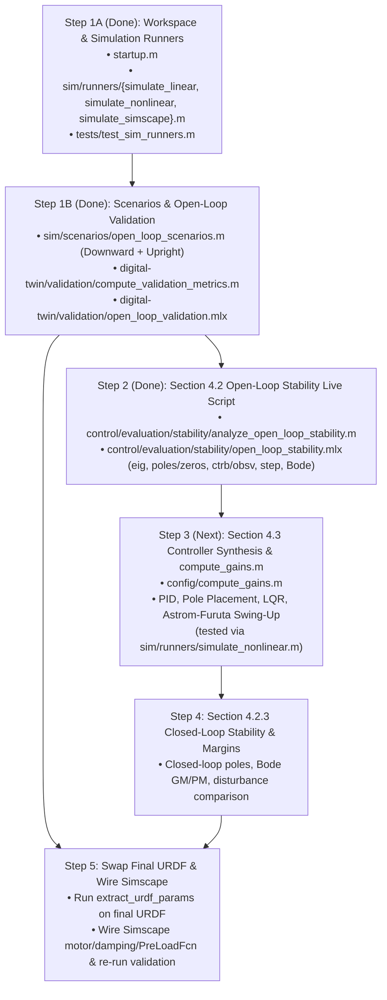

Here is a complete review of what we have built, an assessment of the architecture, a detailed Phase 1 & Phase 2 completion checklist against [Project Description.pdf](file:///d:/Projects/Mechatronics/swing/docs/Project%20Description.pdf), and a concrete execution plan for what to build next.

---

## 1. Review of What Has Been Done So Far

### A. First-Principles 3D Modeling & Code Generation (`digital-twin/models/analytical/`)
* **[furuta_state_space.m](file:///d:/Projects/Mechatronics/swing/digital-twin/models/analytical/furuta_state_space.m) & [furuta_state_space.mlx](file:///d:/Projects/Mechatronics/swing/digital-twin/models/analytical/furuta_state_space.mlx):**
  * **Modeling Assumptions (Section 4.1):** Explicitly states rigid links/ideal revolute joints, axisymmetric slender pendulum rod ($J_{1,\parallel}\approx 0$), linear viscous pivot damping ($b_0, b_1$), and linear DC motor dynamics ($L_a \approx 0$, rigid gearbox ratio $N$, rotor inertia $J_m$).
  * **Section 1 (3D Cartesian Kinematics & Lagrangian):** Defines 3D COM coordinates $(X_{\text{COM}}, Y_{\text{COM}}, Z_{\text{COM}})$ directly from the top-view geometry, differentiates via Symbolic Math Toolbox to capture the full 3D velocity squared $v^2$ (including radial sweep $l_1^2\sin^2\theta_1\,\dot{\theta}_0^2$), includes 3D transverse rod rotation $\frac{1}{2}J_1(\dot{\theta}_1^2 + \sin^2\theta_1\,\dot{\theta}_0^2)$, and forms $L = T - V$.
  * **Section 2 (Euler–Lagrange EOMs):** Derives the full 3D nonlinear equations, exposing the Coriolis torque $+\hat{J}_1\sin(2\theta_1)\dot{\theta}_0\dot{\theta}_1$ and centrifugal flinging torque $-\frac{1}{2}\hat{J}_1\sin(2\theta_1)\dot{\theta}_0^2$, while showing the $-m_1 L_0 l_1\sin\theta_1\,\dot{\theta}_0\dot{\theta}_1$ cancellation.
  * **Section 3 (Manipulator Form):** Extracts $M(\mathbf{q})$, $\mathbf{g}(\mathbf{q})$, and the full $2\times 2$ Christoffel Coriolis/centrifugal matrix $C(\mathbf{q},\dot{\mathbf{q}})$ (verified $C(\mathbf{q},\dot{\mathbf{q}})\dot{\mathbf{q}} = \mathbf{c}(\mathbf{q},\dot{\mathbf{q}})$).
  * **Section 4 (Torque-Driven Linearization):** Shows all 3D terms vanish to first order near equilibrium and follows an inductive 3-step pedagogical flow:
    1. **4.1 Upright ($\theta_1 = 0$)** derived manually step-by-step ($M_{\text{up}}, \mathbf{f}_{\text{up}}, D_{\text{up}}, M_{\text{up}}^{-1}, \ddot{\mathbf{q}}_{\text{up}}, A_{\text{up}}, B_{\text{up}}$).
    2. **4.2 Downward ($\theta_1 = \pi + \tilde{\theta}_1$)** ($\cos\theta_1 \approx -1, \sin\theta_1 \approx -\tilde{\theta}_1$).
    3. **4.3 Unified Pattern ($c_{\text{eq}} = \cos\theta_{1,\text{eq}} \in \{+1, -1\}$)** showing why $D$ and $A_{23}$ are invariant ($c_{\text{eq}}^2 = 1$) while $A_{43}$ and $B_4$ flip sign.
  * **Section 5 (Full Electromechanical Model):** Incorporates rotor inertia $J_m$ into $\hat{I}_0 = I_0 + N^2 J_m + m_1 L_0^2$, gearbox $N$, DC motor voltage $V_a$, back-EMF $k_b$, and viscous damping $b_0, b_1$:
    * **5.1–5.3:** Upright $\to$ Downward $\to$ Unified $(A_{\text{full}}(c_{\text{eq}}), B_{\text{full}}(c_{\text{eq}}))$ (showing damping cross-terms $A_{24}, A_{42}$ also flip sign with $c_{\text{eq}}$).
    * **5.4:** Converts Section 3's implicit manipulator equations step-by-step into the explicit 3D voltage-driven nonlinear state equation $\dot{\mathbf{x}} = \mathbf{f}_{\text{nl}}(\mathbf{x}, V_a)$ ($M_{\text{nl}} \to \boldsymbol{\tau}_{\text{net}} \to D_{\text{nl}}, M_{\text{nl}}^{-1} \to \ddot{\mathbf{q}}_{\text{nl}} \to \mathbf{f}_{\text{nl}}, \mathbf{y}_{\text{nl}}$).
  * **Section 6 (Symbolic Verification & Codegen):** Symbolically proves that the partial derivatives of $\mathbf{f}_{\text{nl}}(\mathbf{x}, V_a)$ at $\theta_1 = 0$ and $\theta_1 = \pi$ match $(A_{\text{full,up}}, B_{\text{full,up}})$ and $(A_{\text{full,down}}, B_{\text{full,down}})$ identically, and auto-generates:
    * [furuta_linear_generated.m](file:///d:/Projects/Mechatronics/swing/config/private/furuta_linear_generated.m) (`[A, B, C, D]`)
    * [furuta_nonlinear_generated.m](file:///d:/Projects/Mechatronics/swing/config/private/furuta_nonlinear_generated.m) (`[xdot, y]` with $4\times 1$ state vector `x`)

### B. Configuration SSOT & Unified Plant Builder (`config/` & `tests/`)
* **[load_parameters.m](file:///d:/Projects/Mechatronics/swing/config/load_parameters.m):** Stateless function `params = load_parameters()` storing **only** raw hardware, electrical, limit, encoder ($\ge 360\text{ PPR}$), and sample time ($T_s = 2\text{ ms}$) constants with `% TODO` tags.
* **[extract_urdf_params.m](file:///d:/Projects/Mechatronics/swing/config/extract_urdf_params.m):** Standalone utility `cad = extract_urdf_params(urdf_path)` applying `<origin rpy>` inertia tensor rotation, the parallel-axis theorem for $I_0$, and joint-axis projection for $L_0, l_1, J_1$.
* **[build_plant.m](file:///d:/Projects/Mechatronics/swing/config/build_plant.m):** Stateless function `plant = build_plant(params)` validating parameter bounds, computing `plant.derived` (`I0_hat`, `J1_hat`, `D`, `b_eff`), and building `plant.upright`, `plant.downward` (zero hardcoded matrices), and `plant.nonlinear` (`.rhs(x, Va)` for `ode45`, `.output(x, Va)`).
* **[test_config.m](file:///d:/Projects/Mechatronics/swing/tests/test_config.m):** 11 automated unit tests checking parameter contracts, independent symbolic equivalence, $N^2 J_m$ scaling, eigenvalue signatures, sweep isolation, error guards, URDF extraction, finite-difference nonlinear-to-linear Jacobians, small-angle `ode45` vs. `lsim`, and 3D centrifugal flinging.

### C. Unified Digital Twin & Modular Simulation Layer (`digital-twin/` & `sim/`)
* **Repository Architecture Refactor (Completed):**
  * Unified all plant representations under `digital-twin/models/` (`analytical/`, `simscape/`, `urdf/`, `mujoco/`) and created `digital-twin/validation/` for model-vs-model fidelity verification (separating plant validation from controller evaluation in `control/evaluation/`).
  * Created root `sim/` (`sim/runners/` and `sim/scenarios/`) and removed `control/controllers/open-loop/`.
* **[startup.m](file:///d:/Projects/Mechatronics/swing/startup.m):** Root workspace/path initializer adding `config/`, `sim/{runners,scenarios}/`, `digital-twin/{models,validation}/`, `control/`, and `tests/` and populating `params` and `plant` without overwriting existing overrides.
* **`sim/runners/` (`simulate_linear.m`, `simulate_nonlinear.m`, `simulate_simscape.m`):** Standardized runners returning `[res.t, res.x, res.y, res.u, res.meta]` in global coordinates $\mathbf{x} = [\theta_0, \dot{\theta}_0, \theta_1, \dot{\theta}_1]^T$, supporting open-loop profiles, closed-loop controllers (`@(t, x)`), $\pm V_{\max}$ saturation, and non-destructive `Simulink.SimulationInput` Simscape execution.
* **[test_sim_runners.m](file:///d:/Projects/Mechatronics/swing/tests/test_sim_runners.m):** Automated unit tests covering `startup.m`, linear/nonlinear small-angle agreement, 3D undamped energy conservation, closed-loop saturation, input guards, and live Simscape `simlog` extraction.
* **`sim/scenarios/` & `digital-twin/validation/` (`open_loop_scenarios.m`, `compute_validation_metrics.m`, `open_loop_validation.m`/`.mlx`, `tests/test_validation.m`):** 9-scenario open-loop validation catalog (5 downward + 4 upright mirror scenarios), quantitative RMSE/NRMSE + logarithmic decrement + upright topple growth-rate metrics, report-ready Live Script with guarded Simscape hook, and automated test suite.

---

## 2. Review of the Engineering Approach

| Architectural Decision | Why It Works Well for This Project | Remaining Nuance to Watch |
|---|---|---|
| **Symbolic Live Script $\to$ `matlabFunction` Codegen** | Eliminates manual transcription bugs between the derivation and MATLAB code; `build_plant(params)` runs in $< 0.5\text{ ms}$ with zero runtime Symbolic Math Toolbox overhead. | Whenever you modify equations in `furuta_state_space.m`, re-run `openAndSave` + `run('...mlx')` so `config/private/*.m` stay synced. |
| **Pure Functions (`load_parameters`, `build_plant`)** | Prevents base-workspace pollution, works identically in Live Scripts, Simulink callbacks, and App Designer, and makes parameter-uncertainty sweeps trivial (`p2 = params; p2.b1 = ...`). | Simulink blocks need `params`/`plant` in the base workspace (or model workspace), so `startup.m` and `PreLoadFcn` must be wired in the next step. |
| **Explicit URDF Extractor (`extract_urdf_params`) vs. Live XML Parsing** | Protects controllers from raw CAD export quirks (like the temporary `4 mm` arm offset in `robot.urdf`) and allows smooth transition from CAD estimates to experimental SysID values. | Remember to run `extract_urdf_params` once the final URDF is exported and paste the verified numbers into `load_parameters.m`. |
| **3D Nonlinear Dynamics + Dual Equilibria ($c_{\text{eq}} = \pm 1$)** | `plant.nonlinear.rhs` includes the exact 3D centrifugal/Coriolis terms that Simscape Multibody solves, while `plant.downward` enables multi-second open-loop validation without exponential blow-up. | State vector is locked to $\mathbf{x} = [\theta_0, \dot{\theta}_0, \theta_1, \dot{\theta}_1]^T$—all downstream Simulink Muxes, `compute_gains.m`, and firmware packets must follow this exact ordering. |

---

## 3. Phase 1 & Phase 2 Checklist (Against `Project Description.pdf`)

### Phase 1 (Week 6 Gate — Section 4.1 & Section 8.1)
* [x] **4.1.1 Nonlinear EOM derivation & explicit modeling assumptions** (completed in `furuta_state_space.mlx`).
* [x] **4.1.2 Parameter SSOT & URDF extraction pipeline** (`load_parameters.m`, `extract_urdf_params.m` complete with baseline values).
* [ ] **4.1.2 (Hardware/CAD follow-up):** Replace `% TODO` baselines in `load_parameters.m` once final URDF is exported and experimental SysID tests (log decrement $b_1$, compound pendulum $J_1$, bifilar $I_0$, locked-rotor $R_m, k_t, k_b$) are performed; document the ID procedure.
* [x] **4.1.3 Linearization & state-space representation** (completed for both upright $\theta_1 = 0$ and downward $\theta_1 = \pi$ in `furuta_state_space.mlx` and `build_plant.m`).
* [ ] **4.1.4 Complete Simscape Multibody plant & open-loop consistency validation:**
  * [x] Create root `startup.m` and modular simulation runners (`sim/runners/simulate_linear.m`, `simulate_nonlinear.m`, `simulate_simscape.m`) with unit tests (`tests/test_sim_runners.m`).
  * [x] Create `sim/scenarios/open_loop_scenarios.m` (5 downward + 4 upright mirror scenarios) and `digital-twin/validation/` (`compute_validation_metrics.m`, `open_loop_validation.m`/`.mlx`, `tests/test_validation.m`) overlaying **Linear (`lsim`) vs. Nonlinear Analytical (`ode45`)** with guarded **Simscape Multibody** hook ($\text{NRMSE} < 3\%$ gate).
  * [ ] Swap final URDF/meshes into `digital-twin/models/simscape/`, wire `PreLoadFcn`, joint damping ($b_0, b_1$), and voltage-to-torque motor dynamics ($N, R_m, k_t, k_b, J_m$) parameterized from `params` (tracked in [deferred_backlog.md](file:///d:/Projects/Mechatronics/swing/docs/logs/deferred_backlog.md)).

### Phase 2 (Week 9 Gate — Sections 4.2, 4.3 & Section 8.1)
* [x] **4.2.1 (Backend computation):** Upright and downward state matrices and eigenvalue computation (`plant.eig_upright`, `plant.eig_downward`).
* [x] **4.2.1 & 4.2.2 Open-Loop Stability, Controllability, Observability & Non-Minimum Phase Zero Analysis:**
  * [x] Dedicated analyzer (`control/evaluation/stability/analyze_open_loop_stability.m`), pedagogical Live Script (`open_loop_stability.m`/`.mlx`), and unit tests (`tests/test_stability.m`) presenting upright vs. downward eigenvalues, zoomed pole–zero maps & non-minimum phase zeros (`tzero`, `minreal`), Kalman controllability & observability rank proofs (`ctrb`, `obsv` across encoder subsets), unit-voltage step responses (`step`), and open-loop Bode plots (`bode`).
* [ ] **4.3 Controller Design, Tuning & Simulation (3 Stabilizing + 1 Swing-Up):**
  * [ ] **`config/compute_gains.m`:** Central gain synthesizer consuming `(plant, params)` and returning `gains` (`K_pid`, `K_pp`, `K_lqr`, `k_E`).
  * [ ] **4.3.1 PID Controller (`control/controllers/classical/pid/`):** PID on $\theta_1$ with derivative filter $N_f/(1 + N_f/s)$ + arm-centering PD on $\theta_0$ (to stabilize the $\lambda = 0$ cyclic mode).
  * [ ] **4.3.2 Pole-Placement Controller (`control/controllers/classical/pole_placement/`):** Transient spec selection ($\zeta, \omega_n$, settling time $T_s$) $\to$ desired poles $\to$ $K_{\text{PP}}$ via `place`/`acker`.
  * [ ] **4.3.3 LQR Controller (`control/controllers/optimal/lqr/`):** Bryson's rule $Q, R$ selection and justification $\to$ $K_{\text{LQR}} = \text{lqr}(A_{\text{up}}, B_{\text{up}}, Q, R)$.
  * [ ] **4.3.4 Energy-Based Swing-Up (`control/stateflow/` or `control/controllers/`):** Åström–Furuta energy pump law $E(\theta_1, \dot{\theta}_1) \to 0$ with $\pm V_{\max}$ saturation.
  * [ ] **Simulation verification for all controllers** on the nonlinear ODE (`plant.nonlinear.rhs`) and Simscape plant before hardware deployment.
* [ ] **4.2.3 Closed-Loop Stability Analysis:**
  * [ ] Closed-loop eigenvalues $\text{eig}(A_{\text{up}} - B_{\text{up}}K)$ for Pole Placement and LQR, open-loop Bode gain and phase margins (`margin`) for PID (and loop margins for LQR), plus discrete-time sanity check at `params.Ts`.

---

## 4. Detailed Suggestions on How to Proceed Next

Even before your final CAD URDF or physical hardware is ready, **100% of the code and Live Scripts below can be built right now** against `load_parameters()` and `build_plant()`. When the final URDF and SysID numbers arrive, updating `load_parameters.m` will automatically regenerate every figure and gain.

### Step 1A: Workspace Bootstrapping & Modular Simulation Runners (Completed)
1. **Root `startup.m`:** Adds `config/`, `sim/{runners,scenarios}/`, `digital-twin/{models,validation}/`, `control/`, and `tests/` to the MATLAB path (no `restoredefaultpath`) and initializes `params` and `plant` safely.
2. **`sim/runners/`:** Standardized `simulate_linear.m`, `simulate_nonlinear.m`, and `simulate_simscape.m` sharing the global-coordinate result struct `res.{t, x, y, u, meta}` and verified by `tests/test_sim_runners.m`.

### Step 1B: Open-Loop Scenarios & Model Validation Live Script (Completed)
1. **`sim/scenarios/open_loop_scenarios.m`:** 9-scenario catalog covering both equilibria (`decay_small`, `decay_large`, `step_small`, `step_1V`, `step_2V` + upright mirror suite `upright_fall_small`, `upright_fall_large`, `upright_step_small`, `upright_step_1V`).
2. **`digital-twin/validation/compute_validation_metrics.m` & `open_loop_validation.m`/`.mlx`:** Verifies small-angle $< 1\%$ NRMSE at both equilibria, downward log-decrement vs. eigenvalues, upright RHP topple rate and $B_4 < 0$ sign flip, large-angle period elongation, 3D centrifugal flinging, and a guarded `ENABLE_SIMSCAPE` hook ($\text{NRMSE} < 3\%$). Verified by `tests/test_validation.m`.

### Step 2: Build the Section 4.2 Open-Loop Stability Live Script (Completed)
Implemented `control/evaluation/stability/analyze_open_loop_stability.m`, `open_loop_stability.m`/`.mlx`, and `tests/test_stability.m` covering upright vs. downward eigenvalues, open-loop poles & zeros (`tzero`, `minreal`, non-minimum phase RHP zero check), Kalman controllability & observability rank proofs (`ctrb`, `obsv` across encoder subsets), unit-voltage step responses (`step`), and open-loop Bode diagrams (`bode`).

### Step 3: Build `config/compute_gains.m` & the Four Section 4.3 Controllers
1. **`config/compute_gains.m` (`gains = compute_gains(plant, params)`):**
   * **Pole Placement (`K_pp`):** Choose target settling time $T_s \le 0.8\text{ s}$ and damping $\zeta \approx 0.707$ ($\omega_n \approx 8\text{--}10\text{ rad/s}$) for the dominant pendulum poles, place the remaining arm poles $3\text{--}4\times$ faster or well-damped, and compute `K_pp = place(plant.A_full, plant.B_full, desired_poles)`.
   * **LQR (`K_lqr`):** Form $Q = \text{diag}(q_{\theta_0}, q_{\dot{\theta}_0}, q_{\theta_1}, q_{\dot{\theta}_1})$ and $R = 1/V_{\max}^2$ via Bryson's rule (matching `[theta0; dtheta0; theta1; dtheta1]` ordering!) and compute `[K_lqr, P_are, eig_cl_lqr] = lqr(plant.A_full, plant.B_full, Q, R)`.
   * **PID (`pid_gains`):** Extract $G_{\theta_1}(s) = \text{tf}(plant.sys\_upright(2, 1))$, design filtered PID on $\theta_1$ + PD arm regulation on $\theta_0$.
   * **Åström–Furuta Swing-Up (`k_E`):** Package the energy pump law $u_{\text{swing}}(\mathbf{x})$ with $\pm V_{\max}$ saturation and arm-angle containment.
2. **Simulate all controllers against `plant.nonlinear.rhs` in `ode45`** (recovering from $\theta_1(0) = 10^\circ$ upright disturbance + full swing-up from $\theta_1(0) = \pi$ into linear capture).

### Step 4: Close Section 4.2.3 (Closed-Loop Stability & Margins)
Extend the stability Live Script (or add `closed_loop_stability.mlx`) to report:
* Closed-loop eigenvalues $\text{eig}(A_{\text{full}} - B_{\text{full}}K)$ and damping ratios for PID, Pole Placement, and LQR.
* Bode plot and **Gain/Phase Margins** (`margin`) for the PID loop and LQR loop transfer function $L(s) = K(sI - A_{\text{full}})^{-1}B_{\text{full}}$.

---

Step 1 and Step 2 are complete. Ready to proceed to **Step 3** (`config/compute_gains.m` + PID, Pole Placement, LQR, and Åström–Furuta Swing-Up)!